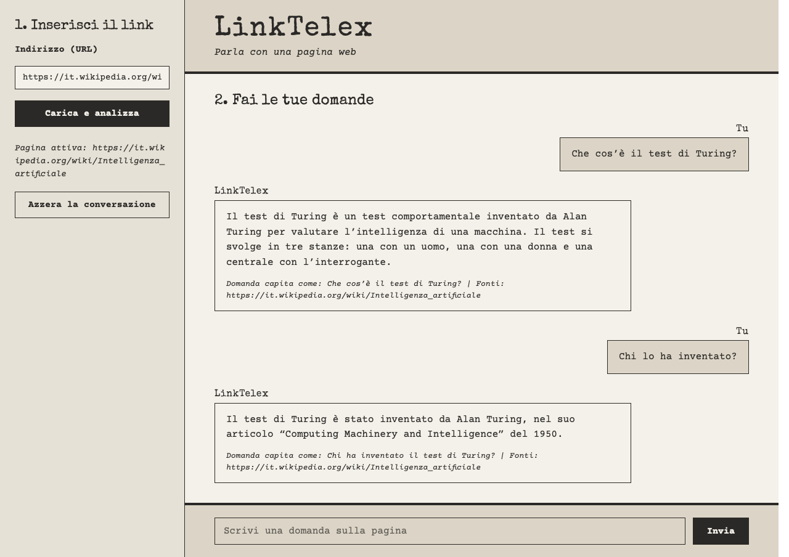

# LinkTelex



Parla con una pagina web: incolli un indirizzo (URL), LinkTelex legge la pagina e puoi farle domande sul contenuto, con memoria della conversazione. Funziona interamente sul proprio computer con Ollama, quindi senza costi e senza chiavi API. Ha un'interfaccia web a tema "macchina da scrivere" (Streamlit) e una versione da terminale.

## Come funziona

1. **Caricamento:** `WebBaseLoader` scarica la pagina e ne estrae il testo.
2. **Divisione:** il testo viene pulito e tagliato in chunk da 1000 caratteri con 150 di sovrapposizione.
3. **Embedding e archivio:** ogni chunk diventa un vettore (`nomic-embed-text`) e viene salvato in Chroma.
4. **Ricerca:** per ogni domanda si recuperano i 4 chunk più vicini.
5. **Risposta:** `llama3.2` risponde usando solo quei chunk e indica la fonte.
6. **Memoria:** la chat ricorda gli ultimi 3 scambi. Prima di cercare, il modello riscrive le domande incomplete (per esempio "In che anno?") in domande autonome, con esempi nel prompt e un piano di riserva se il modello risponde invece di riscrivere.

## Requisiti

- macOS (testato su MacBook Air M1 con 8 GB di RAM)
- Python 3.12
- [Ollama](https://ollama.com) installato e acceso

## Installazione

```bash
git clone https://github.com/giorgiogualtieri/linktelex.git
cd linktelex
python3.12 -m venv .venv
source .venv/bin/activate
pip install -r requirements.txt
ollama pull nomic-embed-text
ollama pull llama3.2
```

## Uso

**Interfaccia web (consigliata):**

```bash
python -m streamlit run app.py
```

Si apre una pagina nel browser: incolla un URL nella barra laterale, clicca "Carica e analizza" e poi fai le tue domande. Il primo avvio può richiedere un po' di tempo, e anche la preparazione di una pagina richiede uno o due minuti perché gli embedding vengono calcolati in locale. Nell'interfaccia l'archivio è tenuto in memoria e va ricreato a ogni avvio.

I font (Special Elite e Courier Prime) vengono scaricati da Google Fonts: senza connessione internet il browser usa un carattere monospazio di riserva.

**Da terminale:**

```bash
python chat.py
```

Scrivi `nuova` per azzerare la conversazione, oppure premi Invio senza scrivere per uscire. `python domande_risposte.py` è la versione senza memoria: ogni domanda è indipendente.

## Valutazione

`valutazione.py` pone sempre le stesse domande a una pagina di Wikipedia e misura tre cose:

- **Pezzo giusto trovato:** la ricerca ha portato il pezzo che contiene la risposta?
- **Risposta corretta:** la risposta contiene le parole chiave attese? Per le domande senza risposta nella pagina, il programma deve rifiutarsi.
- **Riscritture buone:** nella conversazione di prova, le domande incomplete vengono riscritte in domande complete?

```bash
python valutazione.py
```

Ogni esecuzione aggiunge una riga a `storico_valutazioni.txt`, così si possono confrontare le prove.

| Prova | Pezzo giusto trovato | Risposte corrette | Riscritture buone |
|---|---|---|---|
| Base | 3/4 | 5/6 | 0/2 |
| Riscrittura con esempi | 3/4 | 5/6 | 2/2 (*) |
| 6 pezzi invece di 4 | 3/4 | 5/6 | 2/2 |

(*) Il primo controllo era troppo rigido e segnava 1/2: una riscrittura corretta veniva scartata. Dopo averlo corretto il risultato è 2/2, e la prova di base resta 0/2 con entrambe le regole.

Con soli 6 test e 2 riscritture il campione è piccolo: i numeri indicano una direzione, non una prova.

## Struttura del progetto

| File | Cosa fa |
|---|---|
| `app.py` | Interfaccia web con Streamlit |
| `stile.py` | Font e colori del tema a macchina da scrivere |
| `.streamlit/config.toml` | Colori base del tema |
| `chat.py` | Chat con memoria della conversazione (terminale) |
| `domande_risposte.py` | Domande e risposte singole, senza memoria |
| `carica_url.py` | Scarica il testo di una pagina web |
| `dividi_testo.py` | Pulisce il testo e lo divide in chunk |
| `crea_database.py` | Crea gli embedding e l'archivio Chroma |
| `valutazione.py` | Misura la qualità del sistema su domande fisse |
| `storico_valutazioni.txt` | Risultati delle prove di valutazione |
| `esperimento_embedding.py` | Esperimento che mostra la somiglianza tra frasi |
| `diagnosi.py` | Strumento per ispezionare i chunk trovati dalla ricerca |

## Scelte fatte e prove effettuate

Il progetto è stato provato sulla pagina italiana di Wikipedia sull'intelligenza artificiale.

- **Ricerca semplice invece di MMR:** nei miei test l'MMR scartava un chunk pertinente a favore di chunk estranei, quindi uso la ricerca per similarità.
- **Pulizia del testo:** ho rimosso le righe di rimando di Wikipedia ("Lo stesso argomento in dettaglio: ...") e scartato i chunk sotto i 100 caratteri, perché occupavano posti nei risultati senza contenere informazioni.
- **Prompt prudente:** il modello deve rispondere "Non trovo questa informazione nella pagina." se il contesto non contiene la risposta. I due test di rifiuto (mondiali di calcio 2018 e capitale della Francia) sono riusciti in tutte le prove.
- **Riscrittura delle domande:** inizialmente il modello rispondeva invece di riscrivere. Ho aggiunto esempi nel prompt e un controllo: se il risultato non è una domanda, si usa l'ultima domanda dell'utente seguita da quella nuova.
- **Ipotesi smentita:** consegnare 6 chunk invece di 4 non ha migliorato nessuna misura (con una risposta leggermente più confusa), quindi ho mantenuto 4.

| Domanda | Esito |
|---|---|
| Che cos'è il test di Turing? | Risposta fedele alla pagina ma incompleta: manca il criterio con cui una macchina è considerata intelligente |
| Quando si è tenuta la conferenza di Dartmouth? | Corretta (1956) |
| Chi ha vinto i mondiali di calcio del 2018? | Corretto rifiuto: l'informazione non è nella pagina |
| Che cos'è l'apprendimento automatico? | **Errata** nelle prime prove manuali: ha presentato l'apprendimento per rinforzo come definizione generale |
| "Che cos'è il test di Turing?" → "Chi lo ha inventato?" → "In che anno?" | Risposte finali corrette (Alan Turing, 1950) |

## Limiti noti

- **Risposta incompleta sul test di Turing:** il chunk con il criterio finale non viene portato dalla ricerca, nemmeno con 6 chunk. L'ipotesi, ancora da verificare, è che il paragrafo venga spezzato e che la seconda parte, che non nomina Turing, sia poco simile alla domanda.
- Un modello piccolo e locale (`llama3.2`) è meno affidabile dei modelli grandi: può riassumere tagliando parti importanti o confondere categorie e sottocategorie.
- Sulle domande ampie e concettuali la qualità è più bassa che su quelle precise (date, nomi, concetti ben delimitati).
- La ricerca per significato funziona meno bene se la domanda usa un termine diverso da quello della pagina (per esempio "machine learning" invece di "apprendimento automatico").
- La riscrittura delle domande è stata verificata su una sola conversazione breve.
- La pulizia del testo è pensata per Wikipedia: su altri siti andrà adattata.
- Le pagine che mostrano il contenuto solo dopo l'esecuzione di codice nel browser non vengono lette correttamente.
- Nell'interfaccia web l'archivio non viene salvato su disco.

## Possibili miglioramenti

- Verificare se chunk più grandi (circa 1500 caratteri) risolvono il caso del test di Turing.
- Ampliare l'insieme di domande di test e provare conversazioni più lunghe.
- Provare un modello di embedding multilingue (`bge-m3`) e un modello di chat da 3-4 miliardi di parametri, compatibile con 8 GB di RAM.
- Rendere la pulizia del testo configurabile per sito.
- Salvare gli archivi su disco anche nell'interfaccia web.